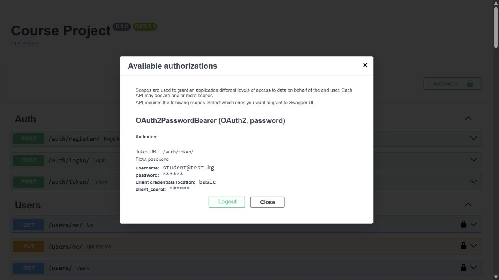
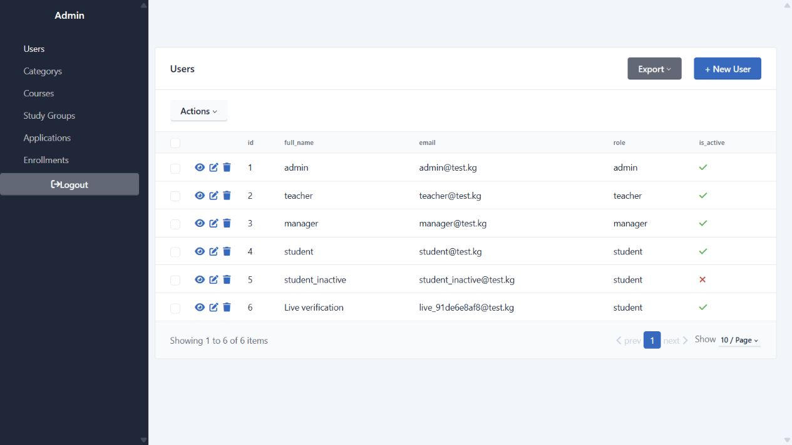

# Отчёт о реализации

Проверка выполнена 31 октября 2026 года. Сервер запущен командой `python main.py`, слушает `127.0.0.1:8001`.
`.venv` не изменялась; зависимости установлены в доступный системный Python 3.12.7. Секреты и JWT в отчёт не включены.
Изначально Git-репозитория не было, поэтому коммиты не создавались.

## Файлы

Изменены:

- `main.py`
- `req.txt`
- `mysite/config.py`
- `mysite/database/db.py`
- `mysite/database/models.py`
- `mysite/database/schema.py`
- `mysite/api/user.py`
- `mysite/api/category.py`
- `mysite/api/course.py`
- `mysite/api/stady_group.py`
- `mysite/api/application.py`
- `mysite/api/enrollment.py`
- `mysite/admin/setup.py`
- `mysite/admin/views.py`
- `mysite/base_knowledge/__init__.py`
- `mysite/chains/ai_search.py`

Созданы:

- `.gitignore`
- `mysite/.env.example`
- `mysite/api/auth.py`
- `mysite/api/deps.py`
- `mysite/api/security.py`
- `mysite/api/common.py`
- `mysite/api/ai.py`
- `mysite/chains/ai_answer.py`
- `mysite/chains/ai_analyze.py`
- `mysite/chains/llm.py`
- `seed.py`
- `pytest.ini`
- `tests/conftest.py`
- `tests/test_access.py`
- `tests/test_business.py`
- `tests/test_ai.py`
- `scripts/verify_live.py`
- `README.md`
- `IMPLEMENTATION_REPORT.md`

Артефакты проверки: `verification/pytest.txt`, `checks.txt`, `server_startup.txt`, `server_stdout.txt`, `live_responses.json`, `swagger_authorized.png`, `admin_users.png`.
`database.db` пересоздан после добавления ограничения `capacity > 0`; затем выполнен seed. Это локальная тестовая БД, миграции не добавлены.

## ТЗ → эндпоинт → доступ → доказательство

| Пункт ТЗ | Эндпоинт | Кто допущен | Подтверждение |
| --- | --- | --- | --- |
| 1.1–1.5, bcrypt/JWT | POST /auth/register/, /auth/login/, /auth/token/ | Все; регистрация только student | Матрица для 5 ролей, тесты дубля email, запрета role, хеша, JWT; живой curl |
| 1.6–1.7 | GET, PUT /users/me/ | Любой с JWT | Матрица, смена пароля и вход с новым; живой curl |
| 1.6 | GET /users/, GET, PUT /users/{id}/ | admin | Матрица, 401/403/404 |
| 2 Category | GET /category/, /category/{id}/ | Все | Матрица включая анонима |
| 2 Category | POST, PUT, DELETE /category/… | admin | Матрица всех ролей |
| 2 Course | GET /course/, /course/{id}/ | Все | Матрица всех ролей |
| 2 Course | POST, PUT, DELETE /course/… | teacher/admin | Матрица; отрицательная цена, нулевая длительность, отсутствующая категория |
| 2 Application Create | POST /application/ | student/admin; ограничения активности и free/plus | 4 комбинации чистой функции; интеграционные 201/403/400/404/422; живой curl |
| 2 Application управление | GET list/detail, PUT, DELETE /application/… | manager/admin | Матрица; manager_id из JWT; живой PUT, отказ студенту 403 |
| 2 Enrollment queryset | GET /enrollment/, /enrollment/{id}/ | student: свои, teacher: свои группы, manager/admin: все | Матрица, queryset для 6 пользователей, чужие GET/PUT/DELETE → 404 |
| 2 Enrollment Create | POST /enrollment/ | student/admin | recruiting, capacity, дубль, успех: 400/400/400/201; живой curl |
| 2 Enrollment изменение | PUT, DELETE /enrollment/{id}/ | В пределах queryset; student PUT только cancelled | Матрица; запрет completed студенту; проверка повторной активации |
| 2 StudyGroup | GET /group/, /group/{id}/ | Все | Матрица |
| 2 StudyGroup | POST, PUT, DELETE /group/… | teacher-владелец/admin | Матрица, чужая группа 403, teacher_id из JWT, валидации дат/ёмкости/FK; CHECK capacity в БД |
| 3.1 | POST /ai/search/ | Все | Точное сравнение курса, фильтров, формы level; кириллица/casefold; живой curl |
| 3.2 | POST /ai/answer/ | Все | Дословные сравнения всех 4 шаблонов; хвостовая пунктуация facts; живой curl |
| 3.3 | POST /ai/analyze/ | Все | Срочность/название курса/русский ответ; 422; живой curl |
| 3 LLM | Все 3 AI-эндпоинта | Все | Имитация LangChain: отсутствие ключа, ошибка, таймаут, неверный JSON, изменённые факты, валидный ответ; дедлайн 20 с |
| 4 | /admin | Только admin | HTTP и браузер: вход admin разрешён, student/teacher/manager отклонены; хеширующий hook; пароля нет в списке |
| 5 | seed.py | Локальный запуск | Повторный реальный запуск и тест неизменности числа записей |
| 7 Swagger | /docs, /auth/token/ | Страница открыта; Authorize по email/паролю | HTTP 200, urlencoded и multipart, браузер Authorized, PNG |
| 7 Сборка | compileall, import main, pip check | Локально | Все exit code 0, предупреждения считаются ошибками |

## Фактический вывод pytest

Команда: `python -m pytest -q -W error`.

```text
........................................................................ [ 27%]
........................................................................ [ 55%]
........................................................................ [ 83%]
............................................                             [100%]
260 passed in 24.85s
```

Сборка ограничена каталогом tests/ в pytest.ini. Тесты используют in-memory SQLite, StaticPool, PRAGMA foreign_keys=ON и dependency_overrides.

## Реальный запуск

```text
INFO:     Started server process [21604]
INFO:     Waiting for application startup.
INFO:     Application startup complete.
INFO:     Uvicorn running on http://127.0.0.1:8001 (Press CTRL+C to quit)
```

```text
> python -W error -m compileall -q main.py seed.py mysite tests scripts
Exit code: 0

> python -W error -c import main; print('main import OK; warnings treated as errors')
main import OK; warnings treated as errors
Exit code: 0

> python -m pip check
No broken requirements found.
Exit code: 0

> python seed.py
Seed completed (existing rows preserved).
Exit code: 0
```

## Живой сценарий curl

Токены скрыты только в отчёте; сценарий использовал настоящие JWT.

```json
[
  {
    "request": "POST /auth/register/",
    "status": 201,
    "response": {
      "id": 6,
      "full_name": "Live verification",
      "email": "live_d7f372c3b0@test.kg",
      "role": "student",
      "user_status": "free",
      "is_active": true
    }
  },
  {
    "request": "POST /auth/login/",
    "status": 200,
    "response": {
      "access_token": "<hidden>",
      "token_type": "bearer"
    }
  },
  {
    "request": "POST /auth/login/",
    "status": 200,
    "response": {
      "access_token": "<hidden>",
      "token_type": "bearer"
    }
  },
  {
    "request": "POST /application/",
    "status": 201,
    "response": {
      "course_id": 2,
      "comment": "Живая проверка",
      "id": 1,
      "student_id": 6,
      "manager_id": null,
      "status": "new"
    }
  },
  {
    "request": "PUT /application/1/",
    "status": 200,
    "response": {
      "course_id": 2,
      "comment": "Кабыл алынды",
      "id": 1,
      "student_id": 6,
      "manager_id": 3,
      "status": "accepted"
    }
  },
  {
    "request": "POST /enrollment/",
    "status": 201,
    "response": {
      "group_id": 1,
      "id": 1,
      "student_id": 6,
      "status": "active"
    }
  }
]
```

Запись была затем прочитана студентом (200), а в конце сценария удалена (200), чтобы освободить тестовое место.
Полные фактические ответы, включая 401/403, Swagger token и вход sqladmin: `verification/live_responses.json`.

## Фактические AI-ответы

Запросы: `Python среднего уровня`; `Верните деньги` с facts `Оплата прошла 3 дня назад`; `Когда начнётся набор?`; `Не могу зайти в личный кабинет, пишет неверный пароль`.
Все ответы — HTTP 200. Порядок полей JSON значения не имеет, timestamps отражают фактический seed.

```json
[
  {
    "request": "POST /ai/search/",
    "status": 200,
    "response": {
      "answer": "Найдено курсов: 1",
      "filters": {
        "keyword": "Python",
        "category_id": null,
        "level": "intermediate",
        "min_price": null,
        "max_price": null,
        "status": null
      },
      "courses": [
        {
          "title": "Python Data Science",
          "category_id": 2,
          "description": "Pandas, NumPy and machine learning basics",
          "level": "intermediate",
          "price": 7500.0,
          "duration_weeks": 16,
          "is_active": true,
          "status": "free",
          "id": 2,
          "created_at": "2026-10-31T12:48:34.431810",
          "updated_at": "2026-10-31T12:48:34.431810"
        }
      ]
    }
  },
  {
    "request": "POST /ai/answer/",
    "status": 200,
    "response": {
      "text_draft": "Здравствуйте! Приносим извинения за неудобства. По нашим данным: Оплата прошла 3 дня назад. Мы передали обращение менеджеру, он проверит оплату и свяжется с вами в ближайшее время.",
      "review": true
    }
  },
  {
    "request": "POST /ai/answer/",
    "status": 200,
    "response": {
      "text_draft": "Здравствуйте! Спасибо за обращение. Мы передали обращение менеджеру, он свяжется с вами в ближайшее время.",
      "review": true
    }
  },
  {
    "request": "POST /ai/analyze/",
    "status": 200,
    "response": {
      "priority": 1,
      "course_name": null,
      "answer": "Здравствуйте! Сожалеем о проблеме со входом или паролем. Мы передали обращение менеджеру, он поможет разобраться и свяжется с вами."
    }
  }
]
```

## Принятые решения

1. Чтение Category, Course и StudyGroup публичное, без JWT. Все три AI-эндпоинта также публичные.
2. «Студент создаёт участие в группе» = POST /enrollment/, а не создание StudyGroup.
3. Admin проходит любую проверку ролей, в том числе создание заявки/участия. При создании student_id всегда равен id пользователя из JWT; отдельного выбора студента для admin нет.
4. Teacher управляет только своими группами. Переданный teacher_id для teacher игнорируется и заменяется id из JWT; admin обязан указать пользователя с ролью teacher.
5. Teacher может менять статусы и удалять участия только своих групп; manager/admin — любых групп. Student может только отменить своё участие или удалить его. Чужие объекты скрыты с 404.
6. is_active=False не блокирует логин: по ТЗ такому студенту разрешена заявка на free. Это поле ограничивает именно заявки на plus. Аналогичного ограничения для enrollment в ТЗ нет, поэтому не добавлено.
7. Принятая заявка не требуется для enrollment, поскольку такого условия нет в ТЗ. Отменённые/завершённые участия не занимают места и не запрещают новую активную запись.
8. Реактивация участия другими ролями повторно проверяет recruiting, capacity и дубль. Проверка мест и запись сериализованы BEGIN IMMEDIATE в SQLite. Capacity нельзя уменьшить ниже текущего числа активных участников через API.
9. PUT для каталога и групп заменяет все поля входной схемы; PUT профиля/админских полей пользователя частичный. В update Application status обязателен, отсутствующий comment сохраняется, явный null очищает comment.
10. Email нормализован casefold. Неизвестные поля тела запрещены (422), в том числе роль при регистрации и student_id при создании заявки/участия. Пароль: минимум 8 символов и максимум 72 UTF-8 байта — ограничение bcrypt.
11. Для AI text/facts выбран максимум 5000 символов, question — 500. Несколько значимых слов keyword объединены поиском всех слов; исходный регистр сохраняется. Категория сопоставляется по полному названию без учёта регистра. При неоднозначном уровне берётся первый уровень из словаря; при нескольких ценовых границах одного типа — последняя.
12. Время создаётся через datetime.now(timezone.utc). SQLite возвращает даты без tzinfo; строковые timestamps в ответах обозначают UTC.
13. /admin без сессии перенаправляет на login, итоговая страница имеет 200; авторизованный admin получает 200 непосредственно. Роль проверяется заново на каждом обращении.
14. LLM включается только явно и при наличии ключа. Для сохранения точных шаблонов и отсутствия выдуманных фактов принимается лишь результат, совпавший с rules; любой иной вывод заменяется rules. Это ограниченная валидация/подтверждение результата, а не свободная генерация.
15. В req.txt добавлены две необходимые зависимости сверх буквального перечня: itsdangerous для сессий sqladmin и AnyIO 4.9.0 для совместимости TestClient без deprecated aliases. Остальные версии соответствуют реально установленному и проверенному набору.
16. Seed сохраняет существующие записи по ключам и не сбрасывает вручную изменённые пароли. Для гарантированного исходного набора используется чистая БД.
17. Во время работы появился отдельный mysite/test_gemini.py с импортом google.genai. Он не изменялся и не выполнялся: pytest.ini собирает только tests/. Пакет google-genai не нужен основному приложению и не добавлен в зависимости.

## Ограничения проверки

- Внешний LLM с реальным ключом не вызывался. Ошибки, таймаут и защита фактов проверены тестовым провайдером; правила проверены на живом сервере без интернета.
- Отдельный ручной Gemini-скрипт не проверялся и требует собственных зависимостей. Это не часть рабочего backend и не часть tests/.
- Проверка параллельной нагрузки/нагрузочное тестирование не выполнялась; SQLite-проверка мест защищена сериализацией записей.
- Секрет .env не изменялся кодом задачи и не включён в артефакты. Существующая .venv не использовалась и не изменялась.

## Интерфейсные доказательства




